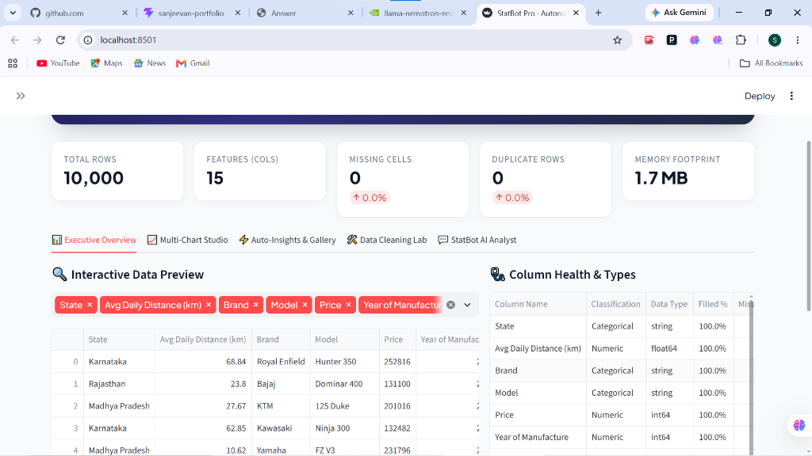
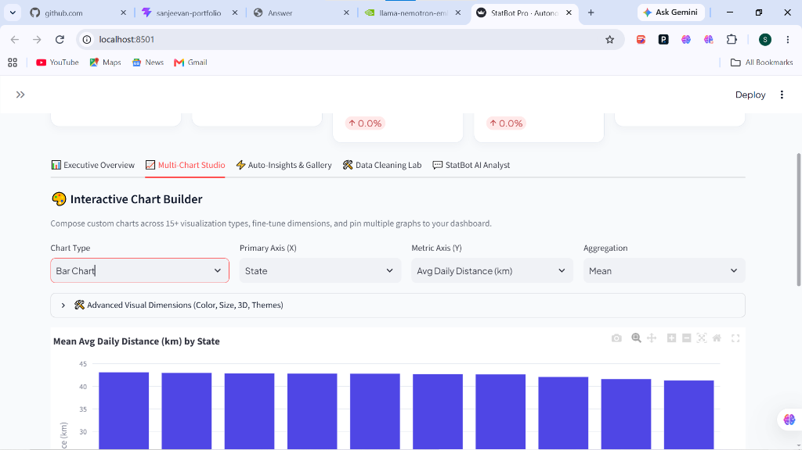
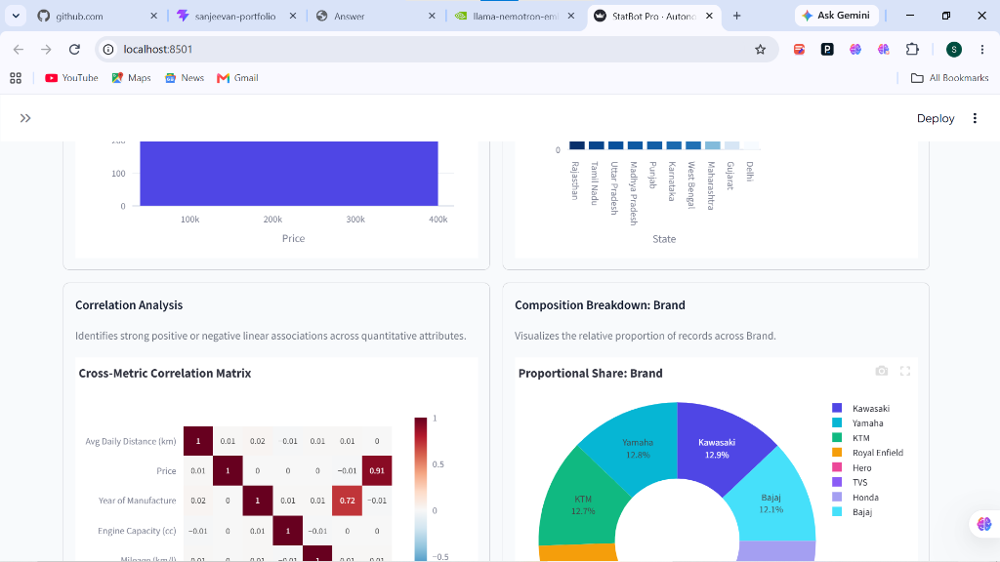
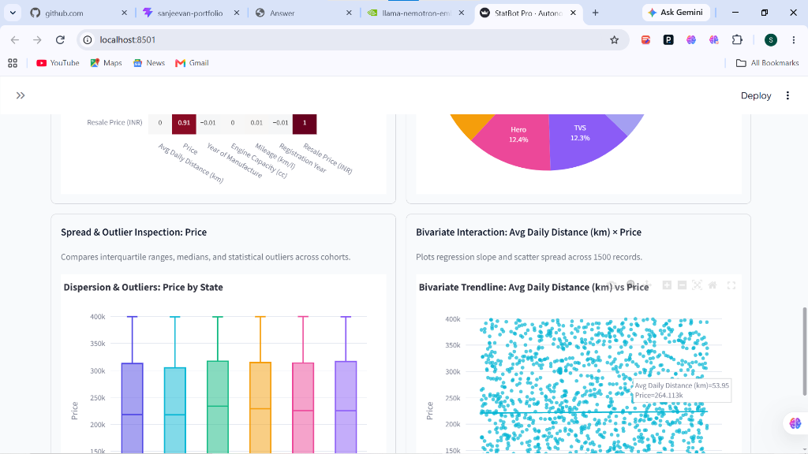
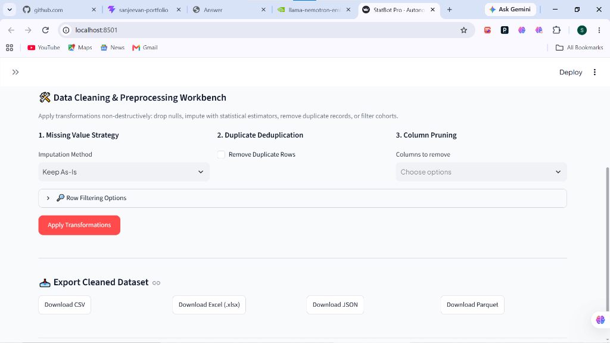
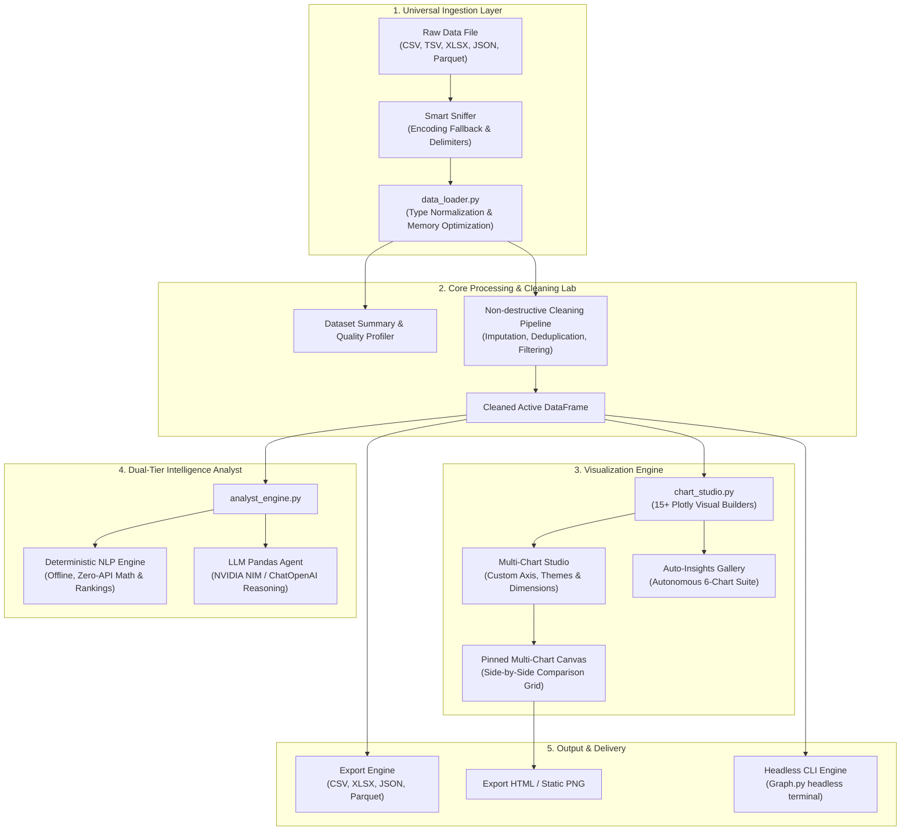

# ◈ StatBot Pro

### Autonomous Data Workspace & Multi-Chart Visual Intelligence Platform

[](https://www.python.org/)
[](https://streamlit.io/)
[](https://plotly.com/)
[](https://www.langchain.com/)
[](https://build.nvidia.com/)
[](LICENSE)

---

## 📖 Table of Contents

- [Overview](#-overview)
- [Key Features](#-key-features)
- [Visual Interface & Feature Tour](#-visual-interface--feature-tour)
  - [1. Executive Overview & Data Health](#1-executive-overview--data-health-diagnostics)
  - [2. Multi-Chart Studio & Interactive Canvas](#2-multi-chart-studio--interactive-canvas)
  - [3. Auto-Insights: Correlation & Composition](#3-autonomous-auto-insights-correlation--composition)
  - [4. Auto-Insights: Dispersion & Bivariate Analysis](#4-statistical-dispersion--bivariate-trendlines)
  - [5. Data Cleaning & Transformation Workbench](#5-data-cleaning--preprocessing-workbench)
- [How It Works (System Architecture)](#-how-it-works-system-architecture)
- [Supported Formats & Sample Datasets](#-supported-formats--sample-datasets)
- [Installation & Quickstart](#-installation--quickstart)
- [How to Work With StatBot Pro (User Guide)](#-how-to-work-with-statbot-pro-user-guide)
- [Headless CLI Engine (Graph.py)](#-headless-cli-engine-graphpy)
- [Configuration & Environment Variables](#-configuration--environment-variables)
- [Project Structure](#-project-structure)
- [Technology Stack](#-technology-stack)
- [License](#-license)

---

## 🔭 Overview

**StatBot Pro** is an enterprise-grade autonomous data workspace designed for data analysts, business intelligence leads, and engineers. It bridges the gap between raw data ingestion, automated exploratory analysis (EDA), custom interactive visualization, data cleaning, and natural language analytics.

Unlike static reporting tools, StatBot Pro provides an **active multi-chart dashboard workspace** featuring 15+ publication-quality Plotly visual types, a side-by-side pinned chart canvas, automatic dataset health profiling, non-destructive data cleaning with instant multi-format export, and a **dual-tier AI conversational analyst** that operates both **100% offline** (zero API keys needed) and with advanced **NVIDIA / OpenAI LLM agents**.

---

## ✨ Key Features

- **Universal Multi-Format Ingestion**: Ingest CSV, TSV, Excel (`.xlsx`, `.xls`, `.xlsm` with multi-sheet browsing), JSON, JSONL, Apache Parquet, and Arrow datasets with automatic delimiter sniffing and encoding fallbacks (`utf-8`, `latin-1`, `cp1252`).
- **Interactive Multi-Chart Studio**: Build 15+ chart types (Bar, Line, Area, Scatter, 3D Scatter, Bubble, Histograms, Box, Violin, Donut, Treemap, Heatmap, Contours, Radar, Funnel) with custom dimensions, aggregations, and palettes.
- **Pinned Multi-Chart Canvas**: Pin multiple graphs to a persistent side-by-side comparison canvas (1-column or 2-column grid) and export them as standalone interactive HTML widgets.
- **1-Click Autonomous Auto-Insights**: Automatically inspects data distributions, calculates cross-metric Pearson correlation matrices, identifies statistical outliers, and plots bivariate regression slopes without requiring user configuration.
- **Data Cleaning & Transform Lab**: Impute missing cells (Median/Mode/Mean), deduplicate rows, prune columns, filter numeric cohorts and categorical subsets, and export the cleaned data into CSV, Excel, JSON, or Parquet.
- **Dual-Tier Conversational AI Analyst**:
  - **Deterministic Smart NLP (Offline)**: Works instantly without any API keys or network connection—computes means, medians, rankings, correlations, and group statistics.
  - **LLM Agent**: Integrates with NVIDIA NIM (`deepseek-ai/deepseek-v3.2`, `llama-3.1-70b`) or OpenAI for complex reasoning and automated code generation.
- **Headless Terminal CLI (`Graph.py`)**: Generate publication-ready figures (`.png`) and query data directly from your command-line interface.

---

## 📸 Visual Interface & Feature Tour

### 1. Executive Overview & Data Health Diagnostics

Upon loading any dataset, StatBot Pro generates an executive KPI summary card panel and an in-depth data health diagnostics profile.



#### Explanation:
- **Top Metric Cards**: Displays real-time metrics including **Total Rows**, **Features (Columns)**, **Missing Cells** (with percentage and delta indicators), **Duplicate Rows**, and **RAM Memory Footprint**.
- **Interactive Data Preview**: An interactive grid supporting column visibility filtering through multi-select tags, allowing quick inspection of raw data records.
- **Column Health & Types Inspector**: Automatically identifies and audits each attribute, classifying them into `Numeric`, `Categorical`, or `DateTime`, while displaying underlying Pandas data types (`int64`, `float64`, `string`), fill rates (`100.0%`), and missing value counters.
- **Descriptive Statistics**: Generates count, mean, standard deviation, interquartile ranges (25%, 50%, 75%), min, and max for every quantitative attribute.

---

### 2. Multi-Chart Studio & Interactive Canvas

The **Multi-Chart Studio** allows users to build, style, and pin custom visual charts to a responsive multi-graph canvas.



#### Explanation:
- **Interactive Chart Builder**: Select from 15+ visual chart engines (Bar, Column, Line, Area, Scatter, 3D Scatter, Bubble, Box, Violin, Donut, Treemap, Correlation Matrix, Density Contours, Radar, Funnel).
- **Flexible Axis & Aggregation Mapping**:
  - **Primary Axis (X)**: Map categorical, discrete, or temporal columns.
  - **Metric Axis (Y)**: Map target quantitative metrics.
  - **Aggregation Function**: Compute `Mean`, `Sum`, `Count`, `Median`, `Min`, or `Max` on the fly.
- **Advanced Visual Dimensions**: Expandable controls for color/legend grouping, bubble size scaling, Z-axis for 3D scatter plots, color palettes (*StatBot Indigo*, *Cyberpunk Neon*, *Deep Ocean*, *Sunset Warmth*), Plotly templates, OLS regression trendlines, and log scaling.
- **Interactive Plotly Canvas**: Includes pan, box zoom, lasso select, hover tooltips, and image capture.
- **📌 Pin to Canvas**: Save active graphs into the **Pinned Multi-Chart Canvas** to compare multiple charts side-by-side in 1-column or 2-column layouts.
- **HTML Export**: Download standalone interactive HTML files with Plotly.js embedded.

---

### 3. Autonomous Auto-Insights: Correlation & Composition

Under the **Auto-Insights & Gallery** tab, StatBot Pro automatically scans the entire dataset to detect structural relationships, dependencies, and categorical distributions.



#### Explanation:
- **Cross-Metric Correlation Matrix**:
  - Evaluates pairwise Pearson correlation coefficients across all numerical attributes.
  - Annotated heatmap with diverging color scales (`-1.0` to `+1.0`) reveals strong positive, negative, or neutral relationships (e.g., strong correlation between vehicle Price and Resale Value).
- **Composition Breakdown (Proportional Share Donut)**:
  - Discovers high-significance categorical attributes and plots their percentage share (e.g., market share across automotive brands like Kawasaki, Yamaha, KTM, Royal Enfield, Hero, TVS, Honda, and Bajaj).
  - Hover tooltips provide exact record counts and proportional share percentages.

---

### 4. Statistical Dispersion & Bivariate Trendlines

StatBot Pro's autonomous intelligence engine performs deep exploratory data analysis to discover outliers and bivariate linear associations.



#### Explanation:
- **Spread & Outlier Inspection (Box-and-Whisker Plots)**:
  - Evaluates interquartile ranges (IQR), medians, 1.5x IQR upper/lower fences, and statistical outliers across cohorts (e.g., vehicle price distributions compared across different geographic states).
  - Enables rapid identification of skewness, data anomalies, and variance across groups.
- **Bivariate Interaction & OLS Regression Trendline**:
  - Compares two continuous variables (e.g., `Avg Daily Distance (km)` vs. `Price`).
  - Computes Ordinary Least Squares (OLS) regression slopes to evaluate trend directions and scatter spreads.
  - Built-in downsampling ensures fast, responsive rendering even on massive datasets.

---

### 5. Data Cleaning & Preprocessing Workbench

The **Data Cleaning Lab** provides a non-destructive transformation pipeline to clean messy records and export the results to various formats.



#### Explanation:
- **1. Missing Value Strategy**:
  - *Keep As-Is*: Preserves existing null entries.
  - *Drop Rows*: Removes any row containing missing values.
  - *Impute Numerics (Median) & Categoricals (Mode)*: Replaces missing numerical values with median estimators and categoricals with most frequent classes.
  - *Impute with Column Mode*: Fills nulls with the column mode.
- **2. Duplicate Deduplication**: 1-click detection and elimination of identical duplicate rows across the dataset.
- **3. Column Pruning**: Multi-select interface to drop irrelevant or sensitive columns before analysis.
- **Row Filtering & Cohort Slicing**: Dynamic sliders for numeric intervals and multi-select tags for categorical cohorts.
- **Non-Destructive & Reversible**: Preview changes immediately with the option to reset to the original raw dataset in one click (`↺ Reset to Original Raw Data`).
- **Multi-Format Export**: One-click download of the transformed dataset in **CSV**, **Excel (`.xlsx`)**, **JSON**, or **Apache Parquet**.

---

## ⚙️ How It Works (System Architecture)

StatBot Pro is architected with modular separation of concerns across ingestion, profiling, analytical computation, visualization, and autonomous reasoning.



### Operational Workflow:
1. **Ingestion & Sniffing (`data_loader.py`)**: The raw byte stream is inspected for file signatures, delimiters (`,`, `;`, `\t`, `|`), and encoding types (`utf-8`, `latin-1`, `cp1252`). Headers are trimmed, and currency/percentage symbols are converted into clean numeric representations.
2. **Health Diagnostics**: The system calculates a dataset health score (`0-100%`), measures memory footprint, detects missing cell ratios, and checks duplicate rates.
3. **Reactive Transformation Pipeline**: Any cleaning or filtering operations create an updated session DataFrame while preserving the raw source in memory for 1-click rollbacks.
4. **Autonomous Visual Generation (`chart_studio.py`)**: Generates Plotly graph objects, attaches responsive hover templates, handles top-N category truncation to prevent browser lag, and injects customized themes.
5. **Dual-Tier Analyst (`analyst_engine.py`)**:
   - Queries are first evaluated by an offline token parser using regex pattern matching and column distance heuristics to compute aggregations, rankings, or correlations directly via Pandas/NumPy.
   - If an `NVIDIA_API_KEY` is present, complex open-ended reasoning tasks are delegated to LangChain agents with code sandbox validation (`Sandbox.py`).

---

## 📁 Supported Formats & Sample Datasets

### Compatible Formats
| Format | Extension | Capabilities & Special Features |
| :--- | :--- | :--- |
| **Comma Separated Values** | `.csv`, `.tsv`, `.txt` | Smart delimiter sniffing (`,`, `;`, `\t`, `|`), auto encoding fallback |
| **Microsoft Excel** | `.xlsx`, `.xls`, `.xlsm` | Multi-sheet inspection with automatic sheet selection dropdown |
| **Apache Parquet** | `.parquet`, `.pq` | High-performance columnar storage with Snappy/Gzip decompression |
| **JavaScript Object Notation**| `.json`, `.jsonl` | Standard tabular JSON arrays and Line-delimited JSON |
| **Apache Arrow / Feather** | `.arrow`, `.feather` | Zero-copy fast memory loading |

### Pre-loaded Sample Datasets
The project comes with diverse ready-to-explore datasets located in `samples/` and root:
- **`sample.csv`**: Comprehensive vehicle specifications and resale values (10,000 rows, 15 columns).
- **`samples/ecommerce_sales.csv` / `.xlsx` / `.json`**: Multi-region retail transactions, revenue, discounts, and customer segments.
- **`samples/hr_analytics.csv` / `.parquet`**: Workforce performance, attrition rates, salaries, and satisfaction scores.
- **`samples/stock_market_trends.csv`**: Financial time-series data with open, high, low, close, and trading volume figures.

---

## 🚀 Installation & Quickstart

### Prerequisites
- Python **3.10** or higher
- `pip` package manager
- (Optional) NVIDIA NIM API Key or OpenAI API Key for LLM reasoning

### 1. Clone the Repository
```bash
git clone https://github.com/your-username/statbot-pro.git
cd statbot-pro
```

### 2. Set Up a Virtual Environment
```bash
# Windows (PowerShell)
python -m venv venv
.\venv\Scripts\Activate.ps1

# Linux / macOS
python3 -m venv venv
source venv/bin/activate
```

### 3. Install Dependencies
```bash
pip install -r requirements.txt
```

### 4. Launch the Web Application
```bash
streamlit run app.py
```
Open your web browser and navigate to:
```
http://localhost:8501
```

---

## 🛠️ How to Work With StatBot Pro (User Guide)

### Step 1: Ingest Data
1. Look at the left sidebar:
   - **Upload Dataset**: Drag-and-drop your custom file (`.csv`, `.xlsx`, `.json`, `.parquet`). If uploading an Excel file with multiple sheets, choose your target sheet from the dropdown.
   - **Pre-Loaded Sample Datasets**: Alternatively, select from pre-loaded samples (*Vehicle Specifications*, *E-Commerce Retail*, *HR Analytics*, or *Stock Market Trends*).

### Step 2: Review Executive Data Health
1. Click on the **📊 Executive Overview** tab.
2. Review the top 5 KPI cards for data size, duplicate rate, and missing cell ratios.
3. Use the multi-select dropdown in **Interactive Data Preview** to inspect specific columns.
4. Check the **Column Health & Types** table to see data classifications, types, and fill rates.
5. Expand **Quantitative Descriptive Statistics** to view medians, standard deviations, and quartiles.

### Step 3: Build Custom Charts & Pin to Canvas
1. Switch to the **📈 Multi-Chart Studio** tab.
2. Select your desired chart type from the **Chart Type** dropdown (e.g., *Bar Chart*, *Scatter Plot*, *3D Scatter Plot*, *Donut / Pie*, *Treemap*).
3. Assign your **Primary Axis (X)** and **Metric Axis (Y)**.
4. Choose an aggregation operation: `Mean`, `Sum`, `Count`, `Median`, `Min`, or `Max`.
5. (Optional) Open **Advanced Visual Dimensions** to add color dimensions, adjust top-N category limits, enable OLS trendlines, or change themes.
6. Click **📌 Pin to Multi-Chart Canvas** to save the chart into your multi-chart comparison dashboard below.
7. Click **📥 Export Interactive HTML** to save the interactive chart for reports.

### Step 4: Explore Autonomous Insights
1. Open the **⚡ Auto-Insights & Gallery** tab.
2. StatBot Pro automatically analyzes column distributions, correlation heatmaps, proportional share donuts, box-plot spreads, and bivariate scatter regression plots.
3. Hover over data points to inspect values, outliers, and interquartile ranges.

### Step 5: Clean & Transform Data
1. Navigate to the **🛠️ Data Cleaning Lab** tab.
2. **Missing Values**: Choose whether to drop rows or impute with medians (numeric) and modes (categorical).
3. **Duplicates**: Check **Remove Duplicate Rows** to eliminate duplicate records.
4. **Pruning**: Multi-select any unwanted columns in **Columns to remove**.
5. **Row Filtering**: Expand **Row Filtering Options** to filter by numeric sliders or categorical values.
6. Click **Apply Transformations** to apply changes.
7. Export your cleaned dataset using the **Download CSV**, **Download Excel (.xlsx)**, **Download JSON**, or **Download Parquet** buttons.
8. If needed, click **↺ Reset to Original Raw Data** to restore the original dataset.

### Step 6: Ask Questions in Natural Language
1. Switch to the **💬 StatBot AI Analyst** tab.
2. Use the **SUGGESTED QUESTIONS** buttons or enter your own query:
   - *"What is the average price?"*
   - *"Top 5 brands by resale value"*
   - *"Correlation between engine capacity and mileage"*
   - *"How many rows and columns are in this dataset?"*
3. Click **Submit Question** to get results. (Operates offline using the deterministic NLP engine, or connects to NVIDIA LLMs if configured).

---

## 💻 Headless CLI Engine (`Graph.py`)

StatBot Pro includes a standalone, headless CLI tool for running terminal queries and generating high-resolution Matplotlib figures:

```bash
python Graph.py
```

### CLI Interactive Commands:
```text
StatBot Pro CLI
Available commands:
  ask <query>                               - Query dataset via AI agent
  plot bar <x> <y> [agg] <filename.png>     - Generate bar chart (mean/sum/count/median/min/max)
  plot hist <col> [bins] <filename.png>     - Generate distribution histogram
  plot line <x> <y> <filename.png>          - Generate line trend plot
  plot area <x> <y> <filename.png>          - Generate area chart
  plot scatter <x> <y> <filename.png>       - Generate 2D scatter plot
  plot box <x> <y> <filename.png>           - Generate box-and-whisker plot
  plot pie <col> <filename.png>             - Generate proportion pie chart
  plot heatmap <filename.png>               - Generate correlation heatmap
  help                                      - Show command help
  quit                                      - Exit CLI
```

#### CLI Examples:
```bash
# Query the dataset via natural language:
ask What is the average resale value for Toyota vehicles?

# Generate a bar chart saved to charts/brand_avg_price.png:
plot bar Brand Price mean brand_avg_price.png

# Generate a correlation heatmap:
plot heatmap correlation_matrix.png
```

---

## 🔐 Configuration & Environment Variables

StatBot Pro works immediately out of the box with zero external configuration. To unlock LLM reasoning capabilities, configure the following environment variables:

| Variable | Default Value | Description |
| :--- | :--- | :--- |
| `NVIDIA_API_KEY` | *(None)* | Your NVIDIA NIM API key (`nvapi-...`). Can also be entered in the web UI. |
| `NVIDIA_MODEL` | `deepseek-ai/deepseek-v3.2` | Model endpoint for LangChain LLM reasoning. |
| `CSV_PATH` | `sample.csv` | Default dataset path for headless CLI (`Graph.py`). |
| `CHART_DIR` | `charts` | Output folder for images generated via CLI. |
| `ALLOW_DANGEROUS_CODE` | `true` | Allows sandboxed local Python AST evaluation for DataFrame queries. |
| `NVIDIA_REQUEST_TIMEOUT` | `90` | API request timeout in seconds. |

To set the API key in your terminal session:
```bash
# Windows PowerShell
$env:NVIDIA_API_KEY="nvapi-your-key-here"

# Linux / macOS
export NVIDIA_API_KEY="nvapi-your-key-here"
```

---

## 📂 Project Structure

```
statbot-pro/
├── app.py                  # Main Streamlit web application & executive workspace
├── chart_studio.py         # 15+ Plotly charts builder, color themes & auto-insights
├── data_loader.py          # Multi-format ingestion, encoding fallbacks & cleaning
├── analyst_engine.py       # Dual-tier analyst (offline smart NLP + LangChain agent)
├── Graph.py                # Standalone headless CLI & Matplotlib chart generator
├── Sandbox.py              # Execution environment & AST security validation
├── requirements.txt        # Production Python dependencies
├── sample.csv              # 10,000-row automotive resale benchmark dataset
├── assets/                 # High-resolution screenshots and UI documentation assets
│   ├── 01_executive_overview.png
│   ├── 02_multi_chart_studio.png
│   ├── 03_auto_insights_correlation.png
│   ├── 04_dispersion_and_bivariate.png
│   └── 05_data_cleaning_lab.png
├── samples/                # Diverse pre-loaded multi-format test datasets
│   ├── ecommerce_sales.csv
│   ├── ecommerce_sales.xlsx
│   ├── ecommerce_sales.json
│   ├── hr_analytics.csv
│   ├── hr_analytics.parquet
│   └── stock_market_trends.csv
└── charts/                 # Default output directory for CLI figures
```

---

## 🧰 Technology Stack

- **Frontend & Web Framework**: [Streamlit](https://streamlit.io/) with custom modern CSS and responsive typography.
- **Interactive Visualizations**: [Plotly Express](https://plotly.com/python/plotly-express/) & [Plotly Graph Objects](https://plotly.com/python/graph-objects/).
- **Static & CLI Visualizations**: [Matplotlib](https://matplotlib.org/) & [Seaborn](https://seaborn.pydata.org/).
- **Data Ingestion & Manipulation**: [Pandas](https://pandas.pydata.org/), [NumPy](https://numpy.org/), [OpenPyXL](https://openpyxl.readthedocs.io/), [PyArrow](https://arrow.apache.org/docs/python/).
- **Statistical Analytics**: [SciPy](https://scipy.org/), [scikit-learn](https://scikit-learn.org/).
- **AI & Conversational Analytics**: [LangChain](https://www.langchain.com/), [LangChain Experimental](https://pypi.org/project/langchain-experimental/), [NVIDIA NIM AI Endpoints](https://build.nvidia.com/).

---

## 📄 License

This project is licensed under the MIT License - see the [LICENSE](LICENSE) file for details.
